# Orchestune 主要施策 ステータス一覧（初期実装・PoC・評価・次アクション）

> **照合基準**: `origin/main` @ `97d0568c`（2026-11-24 JST）。軽量改善 3 点は [#1897](https://github.com/Saltmu/orchestune/issues/1897) で実装。
>
> 本ドキュメントは、初期実装・PoC・実測評価・後続設計が分散している **主要 8 施策** の現在地を 1 か所で俯瞰するためのハブである。各施策の詳細な仕様・契約・測定データ本体は、それぞれの正本ドキュメントおよび GitHub Issue を参照する。

---

## 1. 全体サマリー表

| # | 施策 | 主な Issue / PR | 現在ステージ | 評価判定 | 主な未接続・残課題 | 次に決めること／次アクション |
| :-: | --- | --- | --- | --- | --- | --- |
| 1 | **限定コンテキスト基盤・起動注入**（ScaleMAS） | [#1841](https://github.com/Saltmu/orchestune/issues/1841) (`CLOSED`, PR #1865), [#1868](https://github.com/Saltmu/orchestune/issues/1868) (PR #1870), [#1869](https://github.com/Saltmu/orchestune/issues/1869) (PR #1871), [#1897](https://github.com/Saltmu/orchestune/issues/1897) | 初期実装＋実測完了。軽量改善 3 点は #1897 で実装 | **継続（条件付き）**（Tier 1 `-39.3%`） | 本番のトークンと抽出結果の追跡 | #1897 マージ後に自己除外・フォールバック・`tier2_limit=3` の実運用を見る |
| 2 | **実行履歴の分解計画への還元**（WorkflowOps） | [#1842](https://github.com/Saltmu/orchestune/issues/1842) (`CLOSED`, PR #1881), [#1872](https://github.com/Saltmu/orchestune/issues/1872)–[#1874](https://github.com/Saltmu/orchestune/issues/1874), [#1882](https://github.com/Saltmu/orchestune/issues/1882) (PR #1885), [#1883](https://github.com/Saltmu/orchestune/issues/1883) | PoC＋再検証完了（本体未統合） | **再設計／追加観測**（共有索引統合は不採用） | 適格 6 課題すべてカード返却 0 件（空封筒）、`#1730` 品質 -2、`total_tokens` 欠測 6 | 契約変更（類似度・返却条件・トークン計測）を別 Issue で再設計するか見送るかを判断 |
| 3 | **stale-read（read/write 競合）検出と下流再検証** | [#1230](https://github.com/Saltmu/orchestune/issues/1230) (`CLOSED`, PR #1821) → [#1825](https://github.com/Saltmu/orchestune/issues/1825) (`OPEN`) | ゲート枠組み実装済（既定 `advisory`）・入力接続は設計中 | 未評価（入力自動接続待ち） | 計画の宣言 read と executor の実ツール読取観測が `read-evidence-v1` へ未接続（提出者任せ） | `#1825` の設計承認・子 Issue 分解と実装（`declared_reads` + `adapter_observed` 接続） |
| 4 | **開発手順ガイド・遵守制御**（`workflow next/check`） | [#1417](https://github.com/Saltmu/orchestune/issues/1417) (`CLOSED`, PR #1525) → [#1834](https://github.com/Saltmu/orchestune/issues/1834) (`OPEN`) | 読取専用 CLI 実装済・遵守比較は未実施 | 未測定 | `workflow-adherence-eval.md` の合意表が空欄のままで、Arm A/B 比較試行が未実行 | `#1834` の合意表（モデル・SHA・反復回数・承認者）を確定して測定を実行し、fail-closed 化を判断 |
| 5 | **ローカル初回体験**（`orchestune trial`） | [#1730](https://github.com/Saltmu/orchestune/issues/1730) (`CLOSED`, PR #1749), [#1754](https://github.com/Saltmu/orchestune/issues/1754), [#1890](https://github.com/Saltmu/orchestune/issues/1890) | 初期実装＋Codex スモーク完了。ヘルプ一覧へ露出済み | **継続（採用）** | Claude Code 実走未確認（実施時アカウント制限）、`.serena/` 等未追跡ファイル注意 | Claude Code 実走確認の要否を判断 |
| 6 | **コード解析ツール導入と効果観測**（Serena） | [#822](https://github.com/Saltmu/orchestune/issues/822) (`OPEN`) | 運用導入済・観測継続中 | 観測中（中間評価未了） | 環境により Serena 未使用・テキスト検索フォールバックが混在、コホート集計・5 PR 中間評価が未確定 | コホート基準の確定と 5 PR 中間評価（→ 20 PR 継続判断）の集計 |
| 7 | **操作に応じた追加検証の選択**（AMV-Guard） | [#1843](https://github.com/Saltmu/orchestune/issues/1843) (`OPEN`) | 企画のみ（未着手） | — | 対象操作 1 種の選定、`#1230`/`#1825` との境界整理、VOI 較正可能性の棚卸し | `#1825` の進展も踏まえ、対象操作を 1 つに絞って設計・オフライン PoC を定義 |
| 8 | **並列探索と必須成果統合の計画評価**（s³） | [#1844](https://github.com/Saltmu/orchestune/issues/1844) (`OPEN`) | 企画のみ（未着手） | — | 探索／必須統合／混合の分類定義、既存 DAG/契約情報から取れる構造指標の整理 | オフライン計画群での構造指標棚卸しと、`#1841`/`#1842`/`#660` との境界確定 |

---

## 2. 施策間の関係・責務境界マップ

```mermaid
flowchart TD
    subgraph CTX["コンテキスト・計画履歴系"]
        I1841["#1841 限定コンテキスト基盤\n(実装済・継続)"]
        I1842["#1842 計画履歴の還元 PoC\n(クローズ済・再設計待ち)"]
        I1844["#1844 s³ 計画構造評価\n(OPEN・企画)"]
        I1841 -->|"SQLite索引・抽出契約を共有候補"| I1842
        I1841 -.->|"成果共有の境界"| I1844
        I1842 -.->|"履歴・手戻り記録の境界"| I1844
    end

    subgraph VER["検証・依存整合性系"]
        I1230["#1230 stale-read ゲート\n(枠組み実装済・既定 advisory)"]
        I1825["#1825 宣言read・executor観測接続\n(OPEN・設計)"]
        I1843["#1843 AMV-Guard 追加検証選択\n(OPEN・企画)"]
        I1230 -->|"read-evidence-v1 へ接続"| I1825
        I1230 -->|"決定的な版照合を先行"| I1843
        I1825 -.->|"観測証跡の前提"| I1843
    end

    subgraph DEV["手順遵守・開発体験系"]
        I1417["#1417 workflow next/check\n(読取専用実装済)"]
        I1834["#1834 遵守率の比較測定\n(OPEN・未測定)"]
        I822["#822 Serena コード解析観測\n(OPEN・観測中)"]
        I1730["#1730 ローカル初回体験 trial\n(実装済・継続)"]
        I1417 -->|"合意表を埋めて測定"| I1834
        I822 -.->|"初期影響範囲表(Step 2.6)で連携"| I1417
    end
```

### 共通の設計原則（横断で守る境界）
- **重複基盤を作らない**: 共有コンテキスト・履歴検索は `#1841` の `orchestune/context/` を土台とし、独立 DB や第二の実行状態機械を作らない（`#1842`, `#1844`）。
- **決定的な既存ゲートを弱めない**: `workflow next/check`（`#1417`）、`AMV-Guard`（`#1843`）、`s³`（`#1844`）はいずれも初期段階では読み取り専用の助言に留め、既存の `claim` / CI / レビュー / `complete` / `stale-read-gate` の必須条件を省略・置換しない。
- **実測前に強制化しない**: `#1834`（手順遵守）や `#1842`（計画履歴）のように、事前登録・実測評価を経てから次フェーズ（fail-closed 化・本体統合）を別 Issue で判断する。

---

## 3. 各施策の詳細状況

### 3.1 限定コンテキスト基盤・起動注入（ScaleMAS 企画）
- **関連 Issue / PR**: 親 EPIC [#1841](https://github.com/Saltmu/orchestune/issues/1841)（`CLOSED`, PR #1865）、子 `#1851`–`#1854`、前提修正 [#1868](https://github.com/Saltmu/orchestune/issues/1868)（PR #1870）、PoC 実測 [#1869](https://github.com/Saltmu/orchestune/issues/1869)（PR #1871）、軽量改善 [#1897](https://github.com/Saltmu/orchestune/issues/1897)
- **実装済み範囲**:
  - パッケージ: `orchestune/context/`（`contracts.py`, `extract.py`, `fetch.py`, `storage.py`, `search.py`, `budget.py`, `compose.py`, `cli.py`）
  - CLI: `orchestune context rebuild` / `orchestune context export`
  - 起動注入: `orchestune/dispatch/launch/service.py`（`_launch_context_for` → `compose_for_dispatch`、失敗時は `None` で起動を止めない）および `orchestune/dispatch/targets.py`（ローカル target は session dir に `context.json` を書き出してプロンプト参照付与、クラウド target は本文追記）。対話モード向け読取指示は `skills/local-ci-developer/SKILL.md` に記載済み。
- **評価結果**（正本: [`context-poc-eval.md`](context-poc-eval.md)）:
  - **判定: 継続（条件付き・Tier 1 主軸、Tier 2 は改善のうえ段階適用）**
  - Codex CLI 5 タスク × 3 条件（15 試行）で、計画品質は全試行で `baseline` 同等以上。`input_tokens` は `tier1_only` で **-39.3%**、`tier1_plus_tier2` で **-28.1%**。構成時間は 1.44–5.13 秒（基準 10 秒以下）。
- **#1897 で実装した軽量改善**:
  1. Tier 2 検索の前に対象 `issue_number` 自身を除く。
  2. 定型見出しが無い Issue は、代替見出し、次いでコードフェンスと `Footprint` を除いたチェックリストから受入条件を取る。
  3. `DEFAULT_TIER2_LIMIT = 3`、`DEFAULT_TIER2_MIN_SCORE = 1.0`、`DEFAULT_TIER2_MIN_SCORE_RATIO = 0.5`。
- **次に決めること／次アクション**:
  - #1897 マージ後に、自己除外・フォールバック・上限 3 の実運用トークンを見る。

---

### 3.2 実行履歴の分解計画への還元（WorkflowOps 企画）
- **関連 Issue / PR**: 親 EPIC [#1842](https://github.com/Saltmu/orchestune/issues/1842)（`CLOSED`, PR #1881）、子 [#1872](https://github.com/Saltmu/orchestune/issues/1872)（比較プロトコル）、[#1873](https://github.com/Saltmu/orchestune/issues/1873)（PoC セレクタ CLI）、[#1874](https://github.com/Saltmu/orchestune/issues/1874)（初回探索評価）、[#1883](https://github.com/Saltmu/orchestune/issues/1883)（入力検証修正, PR #1884）、[#1882](https://github.com/Saltmu/orchestune/issues/1882)（適格再検証, PR #1885）
- **実装済み範囲**:
  - 読み取り専用 PoC ツール: `scripts/planning_history_poc.py`（およびテスト `tests/test_planning_history_poc.py`, フィクスチャ `tests/fixtures/planning_history_poc_cases.json`）
  - 比較契約・固定検証バンドル: [`planning-history-poc-protocol.md`](planning-history-poc-protocol.md)、[`planning-history-poc-1882/README.md`](planning-history-poc-1882/README.md)
  - **`orchestune/context/` 本体への統合や `skills/orchestune/SKILL.md` への接続は未実施（意図的に保留）**。
- **評価結果**（正本: [`planning-history-poc-eval.md`](planning-history-poc-eval.md) §8.5）:
  - **判定: 再設計／追加観測（共有索引への統合・分解手順への任意接続は不採用）**
  - `#1882` 適格 6 ペアでリーク 0・必須要件落ち 0・検索時間最大 233 ms は達成した一方、(a) 6 課題すべて `card_returned=0`（空封筒）、(b) 品質合計中央値 0 かつ `#1730` が `-2` で全ペア非悪化未達、(c) usage に `total_tokens` が無く比較可能ペア 0（欠測 6）。
- **未接続ギャップ・残課題**:
  - 現行セレクタ条件では過去計画カードが 1 件も返らず、カード本文の効果自体が未観測。
  - トークン比較の指標定義（`total_tokens` 欠測時の扱い）と類似度・返却契約の再設計が必要。
- **次に決めること／次アクション**:
  - カード返却条件・計測契約を見直す再設計 Issue を新規起票するか、当面保留（他施策優先）とするか判断する。

---

### 3.3 stale-read（read/write 競合）検出と下流再検証
- **関連 Issue / PR**: 親 EPIC [#1230](https://github.com/Saltmu/orchestune/issues/1230)（`CLOSED`, PR #1821）、後続設計 [#1825](https://github.com/Saltmu/orchestune/issues/1825)（`OPEN`）
- **実装済み範囲**:
  - パッケージ: `orchestune/read_dependencies/`（`contracts.py`, `codec.py`, `detection.py`, `git.py`, `report_codec.py`, `snapshot_codec.py`, `storage.py`, `validation.py`）
  - 統合・ライフサイクル接続: `claim` 時の `orchestune-read-checkpoint`（`input_base_sha` 記録）、`orchestune complete --result done --read-evidence <path>` での検証・凍結、`integrator/read_gate.py` での順方向・逆方向検査と親 ref・reader snapshot の原子的更新。
  - 設定: `stale-read-gate = "advisory" | "required" | "off"`（既定値 `advisory`、`orchestune/dispatch/config/model.py`）。運用仕様は [`../ja/setup.md`](../ja/setup.md) / [`../ja/usage.md`](../ja/usage.md) に記載済み。
- **評価結果**:
  - 単体・E2E 回帰テストは実装済みだが、実運用での自動観測ベースの効果測定はまだ未実施。
- **未接続ギャップ・残課題（[#1825](https://github.com/Saltmu/orchestune/issues/1825) `OPEN`）**:
  - 現在の取込口は `orchestune complete --read-evidence` のみで、中身は提出者任せ。
  - **計画に書かれた読み取り依存（`declared_reads`）の自動転記**と、**executor が実際に読んだファイルパスの共通形式観測（`adapter_observed`）**が未接続であり、提出がなければ stale-read 候補が検出されない。
- **次に決めること／次アクション**:
  - `#1825` の設計本文を確認・確定し、子 Issue へ分解して `declared_reads` / `adapter_observed` 接続を実装する。

---

### 3.4 開発手順ガイド・遵守制御（`workflow next` / `workflow check`）
- **関連 Issue / PR**: 親 EPIC [#1417](https://github.com/Saltmu/orchestune/issues/1417)（`CLOSED`, PR #1525）、後続測定 [#1834](https://github.com/Saltmu/orchestune/issues/1834)（`OPEN`）
- **実装済み範囲**:
  - パッケージ: `orchestune/workflow/`（`stages.toml`, `stages.py`, `contracts.py`, `readers.py`, `check.py`, `next.py`, `guidance.py`, `cli.py`）
  - CLI: `orchestune workflow next` / `orchestune workflow check <pre-claim|pre-edit|pre-pr|pre-complete>`（読み取り専用・助言のみ。`claim`/`complete` の必須ゲートにはしていない）
  - スキル案内: `skills/local-ci-developer/SKILL.md` で利用案内を記載済み。
  - 設計正本・比較キット: [`local-ci-workflow-enforcement.md`](local-ci-workflow-enforcement.md)、[`workflow-adherence-eval.md`](workflow-adherence-eval.md)
- **評価結果**:
  - **未測定**。`workflow-adherence-eval.md` §1 の事前合意表（Protocol SHA、モデル、反復回数、目標、承認者等）が空欄のまま。
- **未接続ギャップ・残課題（[#1834](https://github.com/Saltmu/orchestune/issues/1834) `OPEN`）**:
  - Arm A（助言なし）と Arm B（`workflow next/check` あり）の遵守率比較が未実行のため、どの段階を fail-closed ゲート化すべきかの根拠が無い。
- **次に決めること／次アクション**:
  - `#1834` で合意表の項目（特に試験モデル・反復回数・予算上限）を決めて比較測定を実施するか、優先順位を見直すか判断する。

---

### 3.5 ローカル初回体験（`orchestune trial`）
- **関連 Issue / PR**: 親 EPIC [#1730](https://github.com/Saltmu/orchestune/issues/1730)（`CLOSED`, PR #1749）、実エージェントスモーク [#1754](https://github.com/Saltmu/orchestune/issues/1754)
- **実装済み範囲**:
  - パッケージ: `orchestune/local_trial/`（`contracts.py`, `models.py`, `policy.py`, `prompts.py`, `planning.py`, `workspace.py`, `state.py`, `guidance.py`, `service.py`, `cli.py`）
  - CLI: `orchestune trial start | status | resume | result`（GitHub 設定不要で計画 → 承認 → 実装 → CI → 別 worktree レビュー → 手動採用を完結。`orchestune --help` の Getting started に表示する）。
  - 利用手順: `README.md`、[`../ja/setup.md`](../ja/setup.md)、[`../ja/usage.md`](../ja/usage.md) に記載済み。
- **評価結果**（正本: [`local-trial-smoke.md`](local-trial-smoke.md)）:
  - **判定: 継続（採用）**
  - 実 Codex CLI（`codex-cli 0.167.0`）でエンドツーエンド完走（実処理約 71 秒・サイクル 1/3・レビュー 1/3）を実証済み。
- **未接続ギャップ・残課題**:
  - `orchestune --help` の Getting started へ掲載済み（#1890）。
  - Claude Code 実 CLI でのスモーク実行は検証時のサブスクリプション制限により未確認。
  - 実行環境のグローバルプラグインが生成する未追跡ファイル（`.serena/` 等）があると `worktree_dirty` で安全停止するため、対象リポジトリ側の `.gitignore` が前提となる。
- **次に決めること／次アクション**:
  - Claude Code での実走確認を実施するかを判断する。

---

### 3.6 開発者向けコード解析ツール導入と効果観測（Serena）
- **関連 Issue**: [#822](https://github.com/Saltmu/orchestune/issues/822)（`OPEN`・観測継続中）
- **実装済み範囲**:
  - 手順・テンプレート: [`../../skills/local-ci-developer/references/impact-scope.md`](../../skills/local-ci-developer/references/impact-scope.md)（Step 2.6 影響範囲表の初版保存・照合）、[`../../skills/local-ci-developer/references/measurement.md`](../../skills/local-ci-developer/references/measurement.md)（PR 本文・Issue コメントでの記録形式と 5 PR 中間評価 / 20 PR 継続判断基準）。
- **評価結果**:
  - 導入前ベースライン（PR #786–#817 のうちレビュー記録あり 15 PR・独立指摘 46 件）を定義済み。
  - 導入後 PR の個別観測コメントは `#822` に断続的に蓄積中だが、**5 PR 中間評価はまだ未作成**。
- **未接続ギャップ・残課題**:
  - 環境（Codex / Grok / Antigravity 等）によって Serena MCP が未起動・未使用でテキスト検索へフォールバックする PR が混在しており、単一コホートの開始日・包含基準・台帳集計が確定しきっていない。
- **次に決めること／次アクション**:
  - `#822` 上で観測コホートと集計対象を確定し、5 PR 時点の中間評価を出して「継続／改善／撤収」を判断する。

---

### 3.7 操作に応じた追加検証の選択（AMV-Guard 企画）
- **関連 Issue**: [#1843](https://github.com/Saltmu/orchestune/issues/1843)（`OPEN`・企画のみ、未着手）
- **実装済み範囲**: なし（企画 Issue のみ）。
- **目的・位置づけ**:
  - `#1230`（stale-read 契約）・`#1825`（証跡接続）の上で、決定的な版照合だけでは解決しない場合に「追加確認する価値（VOI）があるか」を読み取り専用の助言として提示する構想。
  - 再開時の前提確認、過去レビュー証跡の適用可否、任意の追加レビューが候補（Jev フィルタとの接続は将来候補）。
- **次に決めること／次アクション**:
  - まず `#1825` で観測証跡の前提を整えつつ、適用操作を 1 種類に絞って `#1843` の企画受入条件（必須検証 vs 選択確認の一覧・VOI 較正可能性・オフライン PoC 案）を具体化する。

---

### 3.8 並列探索と必須成果統合の計画評価（s³ 企画）
- **関連 Issue**: [#1844](https://github.com/Saltmu/orchestune/issues/1844)（`OPEN`・企画のみ、未着手）
- **実装済み範囲**: なし（企画 Issue のみ）。
- **目的・位置づけ**:
  - 分解計画の各部分を「並列探索（代替候補の調査）」と「必須成果の統合（全担当の契約・成果が揃う必要あり）」に区別し、必須引継ぎ数・共有契約数・依存の深さ等から計画レビュー向け助言を出す構想。
  - `#660`（クリティカルパス・スケジューリング）、`#1841`（成果共有）、`#1842`（履歴・手戻り記録）との責務重複を避ける前提。
- **次に決めること／次アクション**:
  - 既存の分解計画群を対象に、現行 DAG / `shared_contract` から算出できる構造指標の棚卸しを行い、`#1844` の受入条件を埋める。

---

## 4. 今すぐ優先順位を判断すべき候補

| 優先検討テーマ | 性質 | 根拠・インパクト |
| --- | --- | --- |
| **A. `#1841` コンテキスト注入の軽量改善 3 点** | #1897 で実装済み（マージ待ち） | 自己参照除外、見出しフォールバック、`tier2_limit=3` とスコア閾値を入れた。残る判断はマージ後の実運用トークンの確認。 |
| **B. `#1825` 宣言 read・executor 観測の接続** | 既存ゲートの片肺解消（中規模） | `#1230` の `stale-read-gate` 本体は実装済みだが、自動入力経路が無く未活用状態。`#1843` の前提にもなる。 |
| **C. `#1834` `workflow next` 遵守測定 or `#822` 中間評価** | 効果測定の完了 | どちらも仕組みは導入済みで、測定を回さないまま維持コストだけが残っている。継続・強化・撤収の判断材料を早期に確定できる。 |
| **D. `#1842` 再設計 / `#1843` / `#1844`** | 新規設計・再設計（中〜大規模） | 優先度を明示的に決めてから着手する（`#1842` は再設計前なので本体へ未接続、`#1843`・`#1844` は企画段階）。 |

---

## 5. 更新運用ルール

- **更新タイミング**: 上記施策のいずれかで (1) 新規子 Issue / 統合 PR が `main` にマージされたとき、(2) PoC・実測評価の判定（継続／再設計／見送り）が更新されたとき、(3) 企画 Issue が設計・実装へ移行またはクローズされたとき。
- **更新時の必須項目**: 冒頭の「照合基準（`origin/main` 短縮 SHA と日付）」、第 1 章サマリー表、該当施策の詳細節、必要に応じて第 2 章 Mermaid 図を同期更新する。
- **正本との分離**: 本書はインデックスおよび現在地サマリーであり、詳細なデータ契約・プロトコル・実測ログは各正本ドキュメント（`docs/plans/*.md`）と GitHub Issue に置く。
